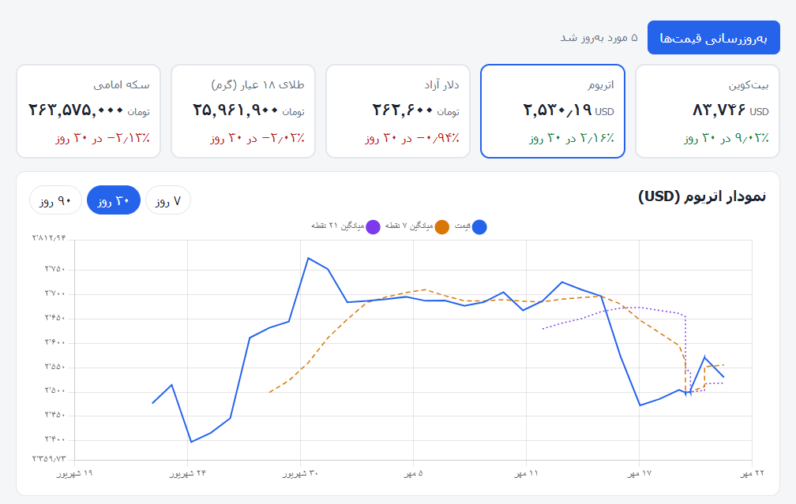
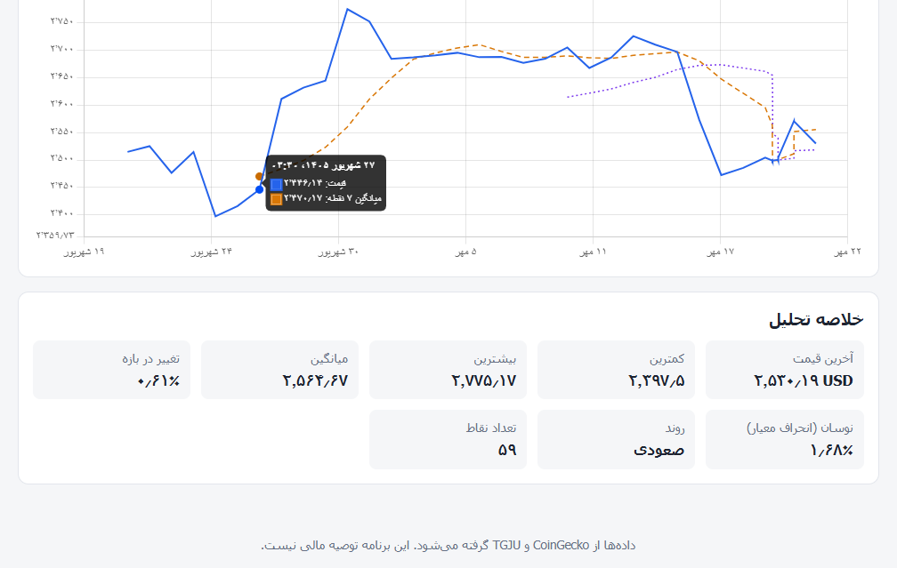

# Market Analyzer

A small Django web app that collects prices of **cryptocurrencies, the US dollar and gold** from the web, stores them in a database and shows them on a dashboard with charts and simple analysis.

> Persian setup guide for beginners: see [`SETUP_FA.md`](SETUP_FA.md).

## Screenshots





## Features

- **Two data-collection strategies** behind one service layer:
  - source has an API → API client (`CoinGecko` for BTC / ETH)
  - source has no API → web scraper (`TGJU` for USD, gold, coin — `requests` + `BeautifulSoup`)
- One failing source never breaks the others; errors are logged to `logs/app.log`.
- Prices stored with the Django ORM (SQLite); duplicate timestamps are ignored.
- Analysis in plain, unit-tested Python: moving averages (7 / 21 points), percent change, volatility (std. dev. of returns), min / max / average, and a simple trend detector.
- Dashboard: asset cards, interactive Chart.js line chart with moving averages, 7 / 30 / 90-day ranges, "refresh prices" button, light / dark theme, RTL Persian UI.
- Demo data (clearly flagged in the UI) so the page works before the first real fetch.
- Django admin for browsing the stored data.

## Tech stack

Python · Django · SQLite · requests · BeautifulSoup4 · Chart.js · HTML / CSS / vanilla JS

## Project structure

```
market_analyzer/
├── config/                  Django project (settings, urls, wsgi/asgi)
├── apps/
│   ├── market_data/         models (Asset, PriceRecord), admin, management commands
│   ├── data_sources/
│   │   ├── api_clients/     coingecko_client.py
│   │   ├── scrapers/        tgju_scraper.py
│   │   ├── services.py      picks API or scraper per asset and saves results
│   │   └── sample_data.py   demo data
│   ├── analysis/            services.py (maths) + views.py (JSON API)
│   └── dashboard/           the HTML page
├── templates/  static/  logs/  tests/
├── .env.example  requirements.txt  manage.py
```

## Run it

```bash
python -m venv venv
source venv/bin/activate          # Windows: venv\Scripts\activate
pip install -r requirements.txt

python manage.py migrate          # creates the database and the asset list
python manage.py seed_demo        # optional: demo data for an instant first look
python manage.py fetch_prices     # download real prices
python manage.py runserver        # open http://127.0.0.1:8000
```

Optional: `cp .env.example .env` to change settings. Admin site: `python manage.py createsuperuser`, then `/admin/`.

## API

| Method | URL | Description |
|---|---|---|
| GET | `/api/assets/` | all assets with a 30-day summary |
| GET | `/api/history/<SYMBOL>/?days=30` | prices + moving averages + summary |
| POST | `/api/refresh/` | fetch new prices from the sources |

## Tests

```bash
python manage.py test
```

Covers the analysis maths, the CoinGecko / TGJU parsers (offline, with sample data), the JSON API and the refresh flow (network calls are mocked).

## Notes and limitations

- Web scrapers depend on the target page's HTML. If TGJU changes its layout, only `PRICE_ATTRIBUTES` in `scrapers/tgju_scraper.py` needs updating.
- Free CoinGecko API is rate limited; do not refresh in a tight loop.
- TGJU only provides the current price, so USD / gold / coin history builds up over time with each fetch (run `python manage.py fetch_prices` regularly). Crypto history is downloaded from CoinGecko on the first fetch.
- Moving averages are calculated over the last N data points, not over a time window, so they can look jumpy when points are unevenly spaced. Time-based averages would be a natural improvement.
- Respect each site's terms of use. This project is for learning and is not financial advice.

## Ideas for next steps

Scheduled fetching (cron / Celery), more assets, price alerts, Docker, deployment.

## About this project

A learning project built with AI assistance (Claude). I ran, tested and studied
the code to understand each part, from data collection to the dashboard.


his change is only on the feature-test branch.